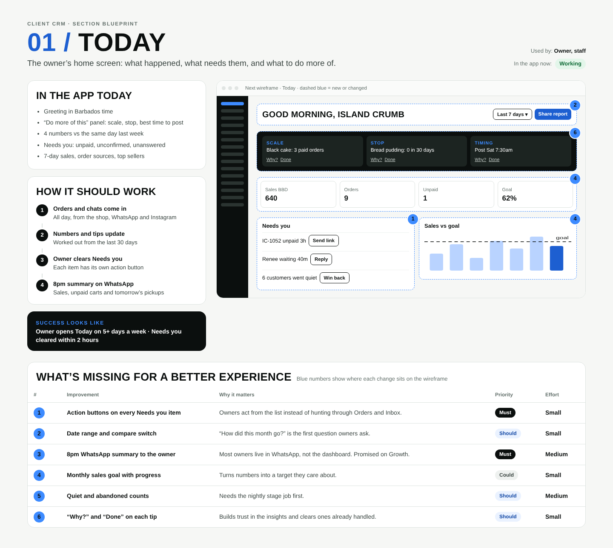

# 01 / Today

**Purpose:** The owner’s home screen: what happened, what needs them, and what to do more of.  
**Used by:** Owner, staff  
**Status in the app today:** Working  
**Success measure:** Owner opens Today on 5+ days a week · Needs you cleared within 2 hours

## Code to start from

- `app/dashboard/[slug]/page.tsx`
- `lib/insights.ts`

## In the app today

- Greeting in Barbados time
- “Do more of this” panel: scale, stop, best time to post
- 4 numbers vs the same day last week
- Needs you: unpaid, unconfirmed, unanswered
- 7-day sales, order sources, top sellers

## How it should work

1. **Orders and chats come in**: All day, from the shop, WhatsApp and Instagram
2. **Numbers and tips update**: Worked out from the last 30 days
3. **Owner clears Needs you**: Each item has its own action button
4. **8pm summary on WhatsApp**: Sales, unpaid carts and tomorrow’s pickups

## Next wireframe (what the screen should contain)

- **bar** Good morning, Island Crumb: actions Last 7 days ▾, Share report (improvement #2)
- **insight** SCALE  Black cake: 3 paid orders, STOP  Bread pudding: 0 in 30 days, TIMING  Post Sat 7:30am (improvement #6)
- **kpis** Sales BBD 640, Orders 9, Unpaid 1, Goal 62% (improvement #4)
- **list** Needs you: IC-1052 unpaid 3h  [Send link]; Renee waiting 40m  [Reply]; 6 customers went quiet  [Win back] (improvement #1)
- **chart** Sales vs goal (improvement #4)

## What's missing (build these)

| # | Improvement | Why it matters | Priority | Effort |
|---|---|---|---|---|
| 1 | Action buttons on every Needs you item | Owners act from the list instead of hunting through Orders and Inbox. | Must | Small (under a day) |
| 2 | Date range and compare switch | “How did this month go?” is the first question owners ask. | Should | Small (under a day) |
| 3 | 8pm WhatsApp summary to the owner | Most owners live in WhatsApp, not the dashboard. Promised on Growth. | Must | Medium (1 to 3 days) |
| 4 | Monthly sales goal with progress | Turns numbers into a target they care about. | Could | Small (under a day) |
| 5 | Quiet and abandoned counts | Needs the nightly stage job first. | Should | Medium (1 to 3 days) |
| 6 | “Why?” and “Done” on each tip | Builds trust in the insights and clears ones already handled. | Should | Small (under a day) |

## Done means

- Works on a 390px phone with no sideways scroll; buttons at least 44px tall; inputs 16px.
- Uses the existing CRM shell (`components/CrmShell.tsx`, `PageHeader`) and styles in `app/globals.css`.
- Any new table has RLS (`private.is_member(business_id) or private.is_staff()`), writes go through server actions with an owner/admin check.
- Pure logic lives in `lib/` with a `node:test` test in `tests/`; `npm test` and `npx tsc --noEmit` pass.
