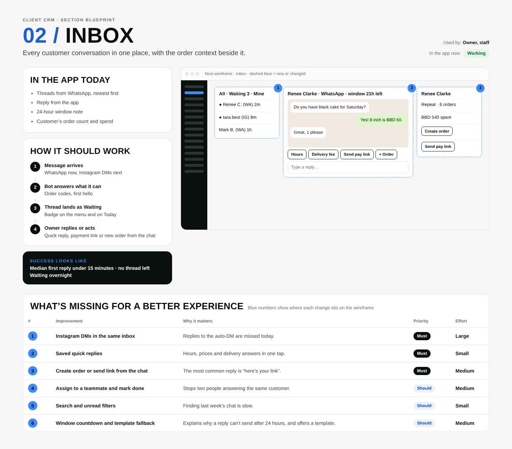

# 02 / Inbox

**Purpose:** Every customer conversation in one place, with the order context beside it.  
**Used by:** Owner, staff  
**Status in the app today:** Working  
**Success measure:** Median first reply under 15 minutes · no thread left Waiting overnight

## Code to start from

- `app/dashboard/[slug]/inbox/page.tsx`
- `lib/payments.ts (sendFromBusiness)`
- `app/api/webhooks/whatsapp/route.ts`

## In the app today

- Threads from WhatsApp, newest first
- Reply from the app
- 24-hour window note
- Customer’s order count and spend

## How it should work

1. **Message arrives**: WhatsApp now, Instagram DMs next
2. **Bot answers what it can**: Order codes, first hello
3. **Thread lands as Waiting**: Badge on the menu and on Today
4. **Owner replies or acts**: Quick reply, payment link or new order from the chat

## Next wireframe (what the screen should contain)

- **list** All · Waiting 3 · Mine: ● Renee C. (WA) 2m; ● tara.best (IG) 8m; Mark B. (WA) 1h (improvement #1)
- **chat** chat (improvement #3)
- **side** Renee Clarke: Repeat · 6 orders; BBD 540 spent; [Create order]; [Send pay link] (improvement #3)

## What's missing (build these)

| # | Improvement | Why it matters | Priority | Effort |
|---|---|---|---|---|
| 1 | Instagram DMs in the same inbox | Replies to the auto-DM are missed today. | Must | Large (more than 3 days) |
| 2 | Saved quick replies | Hours, prices and delivery answers in one tap. | Must | Small (under a day) |
| 3 | Create order or send link from the chat | The most common reply is “here’s your link”. | Must | Medium (1 to 3 days) |
| 4 | Assign to a teammate and mark done | Stops two people answering the same customer. | Should | Medium (1 to 3 days) |
| 5 | Search and unread filters | Finding last week’s chat is slow. | Should | Small (under a day) |
| 6 | Window countdown and template fallback | Explains why a reply can’t send after 24 hours, and offers a template. | Should | Medium (1 to 3 days) |

## Done means

- Works on a 390px phone with no sideways scroll; buttons at least 44px tall; inputs 16px.
- Uses the existing CRM shell (`components/CrmShell.tsx`, `PageHeader`) and styles in `app/globals.css`.
- Any new table has RLS (`private.is_member(business_id) or private.is_staff()`), writes go through server actions with an owner/admin check.
- Pure logic lives in `lib/` with a `node:test` test in `tests/`; `npm test` and `npx tsc --noEmit` pass.
