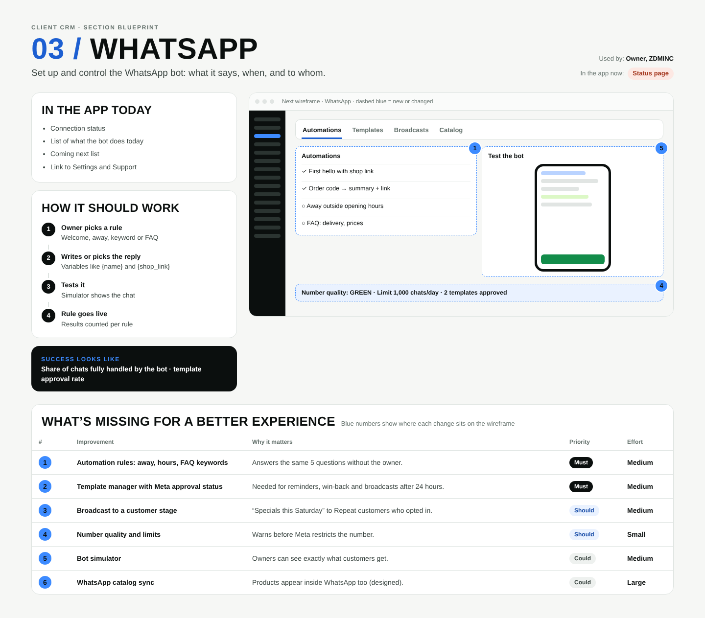

# 03 / WhatsApp

**Purpose:** Set up and control the WhatsApp bot: what it says, when, and to whom.  
**Used by:** Owner, ZDMINC  
**Status in the app today:** Status page  
**Success measure:** Share of chats fully handled by the bot · template approval rate

## Code to start from

- `app/dashboard/[slug]/whatsapp/page.tsx`
- `app/api/webhooks/whatsapp/route.ts`
- `lib/whatsapp.ts`

## In the app today

- Connection status
- List of what the bot does today
- Coming next list
- Link to Settings and Support

## How it should work

1. **Owner picks a rule**: Welcome, away, keyword or FAQ
2. **Writes or picks the reply**: Variables like {name} and {shop_link}
3. **Tests it**: Simulator shows the chat
4. **Rule goes live**: Results counted per rule

## Next wireframe (what the screen should contain)

- **tabs** Automations, Templates, Broadcasts, Catalog
- **list** Automations: ✓ First hello with shop link; ✓ Order code → summary + link; ○ Away outside opening hours; ○ FAQ: delivery, prices (improvement #1)
- **phone** Test the bot (improvement #5)
- **strip** Number quality: GREEN · Limit 1,000 chats/day · 2 templates approved (improvement #4)

## What's missing (build these)

| # | Improvement | Why it matters | Priority | Effort |
|---|---|---|---|---|
| 1 | Automation rules: away, hours, FAQ keywords | Answers the same 5 questions without the owner. | Must | Medium (1 to 3 days) |
| 2 | Template manager with Meta approval status | Needed for reminders, win-back and broadcasts after 24 hours. | Must | Medium (1 to 3 days) |
| 3 | Broadcast to a customer stage | “Specials this Saturday” to Repeat customers who opted in. | Should | Medium (1 to 3 days) |
| 4 | Number quality and limits | Warns before Meta restricts the number. | Should | Small (under a day) |
| 5 | Bot simulator | Owners can see exactly what customers get. | Could | Medium (1 to 3 days) |
| 6 | WhatsApp catalog sync | Products appear inside WhatsApp too (designed). | Could | Large (more than 3 days) |

## Done means

- Works on a 390px phone with no sideways scroll; buttons at least 44px tall; inputs 16px.
- Uses the existing CRM shell (`components/CrmShell.tsx`, `PageHeader`) and styles in `app/globals.css`.
- Any new table has RLS (`private.is_member(business_id) or private.is_staff()`), writes go through server actions with an owner/admin check.
- Pure logic lives in `lib/` with a `node:test` test in `tests/`; `npm test` and `npx tsc --noEmit` pass.
