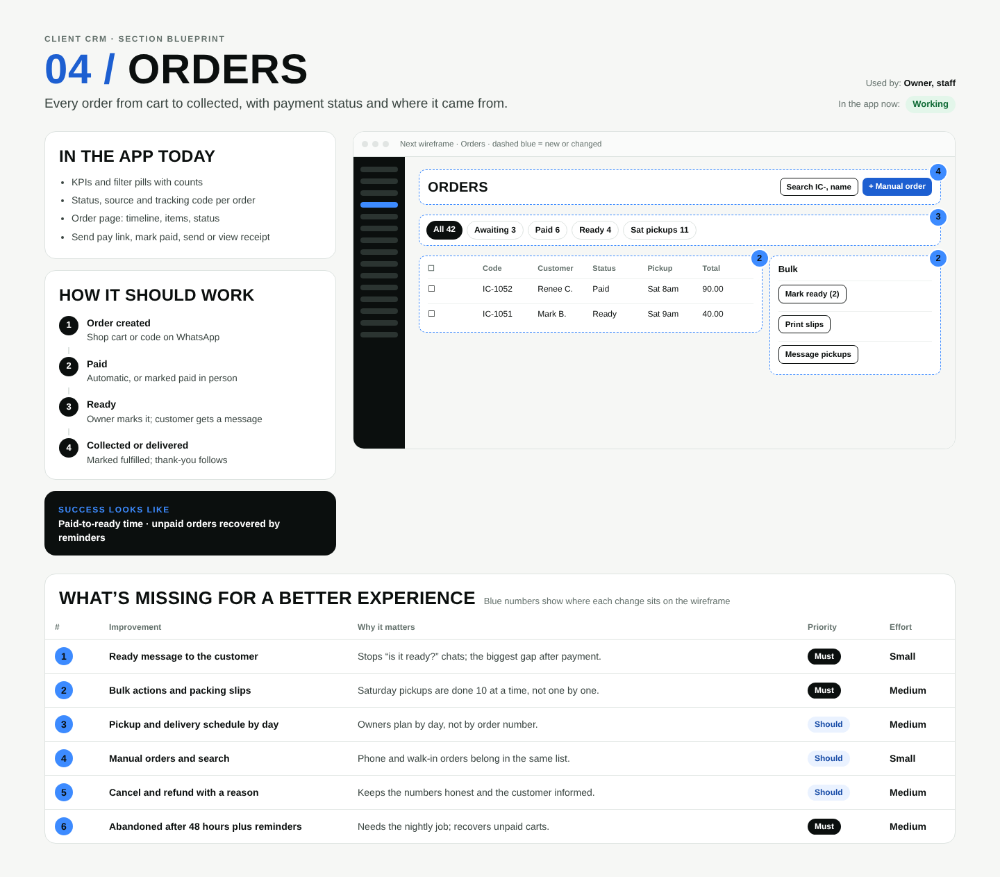

# 04 / Orders

**Purpose:** Every order from cart to collected, with payment status and where it came from.  
**Used by:** Owner, staff  
**Status in the app today:** Working  
**Success measure:** Paid-to-ready time · unpaid orders recovered by reminders

## Code to start from

- `app/dashboard/[slug]/orders/page.tsx`
- `app/dashboard/[slug]/orders/[code]/page.tsx`
- `app/api/orders/route.ts`
- `supabase/migrations/0001_init.sql (mark_order_paid)`

## In the app today

- KPIs and filter pills with counts
- Status, source and tracking code per order
- Order page: timeline, items, status
- Send pay link, mark paid, send or view receipt

## How it should work

1. **Order created**: Shop cart or code on WhatsApp
2. **Paid**: Automatic, or marked paid in person
3. **Ready**: Owner marks it; customer gets a message
4. **Collected or delivered**: Marked fulfilled; thank-you follows

## Next wireframe (what the screen should contain)

- **bar** Orders: actions Search IC-, name, + Manual order (improvement #4)
- **chips** All 42, Awaiting 3, Paid 6, Ready 4, Sat pickups 11 (improvement #3)
- **table** table: ☐ | IC-1052 | Renee C. | Paid | Sat 8am | 90.00; ☐ | IC-1051 | Mark B. | Ready | Sat 9am | 40.00 (improvement #2)
- **side** Bulk: [Mark ready (2)]; [Print slips]; [Message pickups] (improvement #2)

## What's missing (build these)

| # | Improvement | Why it matters | Priority | Effort |
|---|---|---|---|---|
| 1 | Ready message to the customer | Stops “is it ready?” chats; the biggest gap after payment. | Must | Small (under a day) |
| 2 | Bulk actions and packing slips | Saturday pickups are done 10 at a time, not one by one. | Must | Medium (1 to 3 days) |
| 3 | Pickup and delivery schedule by day | Owners plan by day, not by order number. | Should | Medium (1 to 3 days) |
| 4 | Manual orders and search | Phone and walk-in orders belong in the same list. | Should | Small (under a day) |
| 5 | Cancel and refund with a reason | Keeps the numbers honest and the customer informed. | Should | Medium (1 to 3 days) |
| 6 | Abandoned after 48 hours plus reminders | Needs the nightly job; recovers unpaid carts. | Must | Medium (1 to 3 days) |

## Done means

- Works on a 390px phone with no sideways scroll; buttons at least 44px tall; inputs 16px.
- Uses the existing CRM shell (`components/CrmShell.tsx`, `PageHeader`) and styles in `app/globals.css`.
- Any new table has RLS (`private.is_member(business_id) or private.is_staff()`), writes go through server actions with an owner/admin check.
- Pure logic lives in `lib/` with a `node:test` test in `tests/`; `npm test` and `npx tsc --noEmit` pass.
