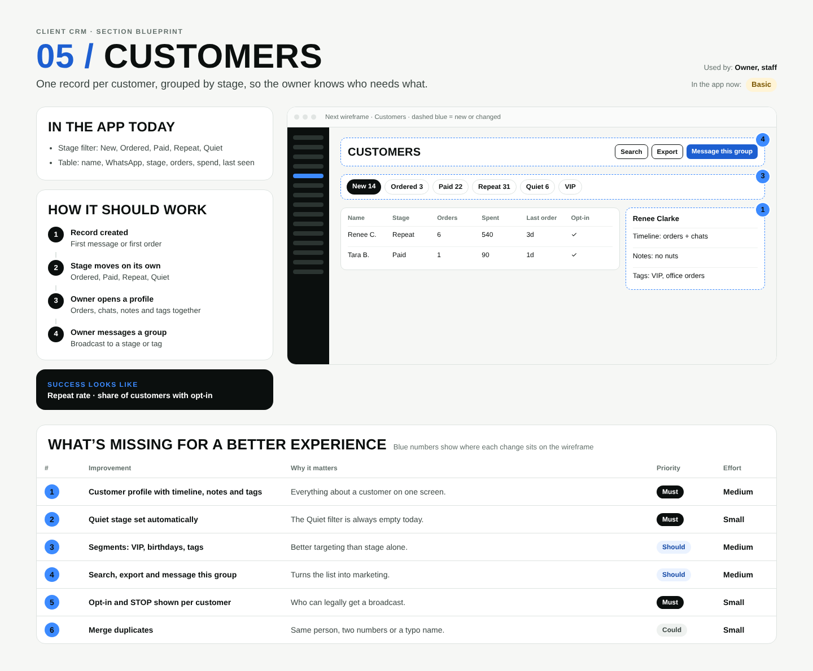

# 05 / Customers

**Purpose:** One record per customer, grouped by stage, so the owner knows who needs what.  
**Used by:** Owner, staff  
**Status in the app today:** Basic  
**Success measure:** Repeat rate · share of customers with opt-in

## Code to start from

- `app/dashboard/[slug]/customers/page.tsx`
- `lib/customers.ts`
- `supabase/migrations/0001_init.sql (customers, customer_stage)`

## In the app today

- Stage filter: New, Ordered, Paid, Repeat, Quiet
- Table: name, WhatsApp, stage, orders, spend, last seen

## How it should work

1. **Record created**: First message or first order
2. **Stage moves on its own**: Ordered, Paid, Repeat, Quiet
3. **Owner opens a profile**: Orders, chats, notes and tags together
4. **Owner messages a group**: Broadcast to a stage or tag

## Next wireframe (what the screen should contain)

- **bar** Customers: actions Search, Export, Message this group (improvement #4)
- **chips** New 14, Ordered 3, Paid 22, Repeat 31, Quiet 6, VIP (improvement #3)
- **table** table: Renee C. | Repeat | 6 | 540 | 3d | ✓; Tara B. | Paid | 1 | 90 | 1d | ✓
- **side** Renee Clarke: Timeline: orders + chats; Notes: no nuts; Tags: VIP, office orders (improvement #1)

## What's missing (build these)

| # | Improvement | Why it matters | Priority | Effort |
|---|---|---|---|---|
| 1 | Customer profile with timeline, notes and tags | Everything about a customer on one screen. | Must | Medium (1 to 3 days) |
| 2 | Quiet stage set automatically | The Quiet filter is always empty today. | Must | Small (under a day) |
| 3 | Segments: VIP, birthdays, tags | Better targeting than stage alone. | Should | Medium (1 to 3 days) |
| 4 | Search, export and message this group | Turns the list into marketing. | Should | Medium (1 to 3 days) |
| 5 | Opt-in and STOP shown per customer | Who can legally get a broadcast. | Must | Small (under a day) |
| 6 | Merge duplicates | Same person, two numbers or a typo name. | Could | Small (under a day) |

## Done means

- Works on a 390px phone with no sideways scroll; buttons at least 44px tall; inputs 16px.
- Uses the existing CRM shell (`components/CrmShell.tsx`, `PageHeader`) and styles in `app/globals.css`.
- Any new table has RLS (`private.is_member(business_id) or private.is_staff()`), writes go through server actions with an owner/admin check.
- Pure logic lives in `lib/` with a `node:test` test in `tests/`; `npm test` and `npx tsc --noEmit` pass.
