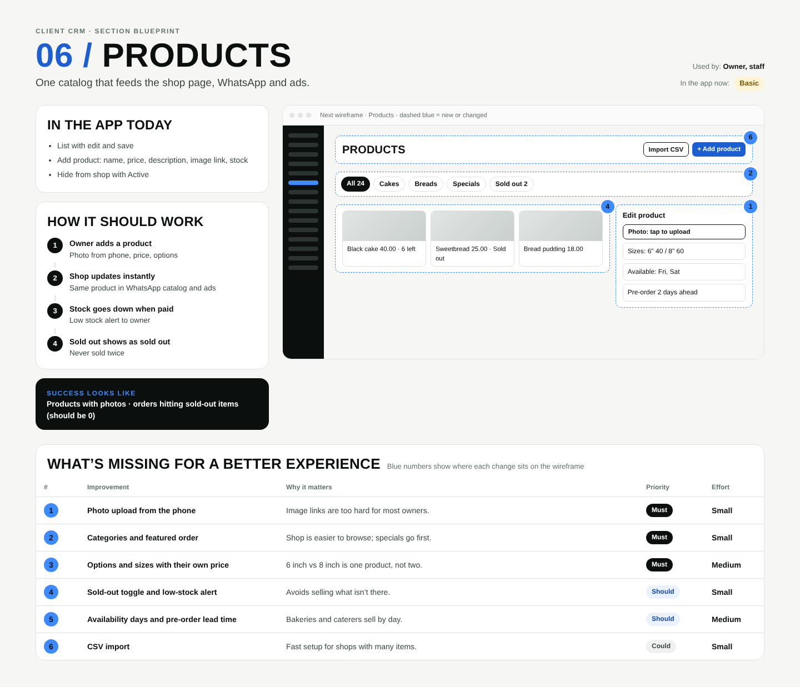

# 06 / Products

**Purpose:** One catalog that feeds the shop page, WhatsApp and ads.  
**Used by:** Owner, staff  
**Status in the app today:** Basic  
**Success measure:** Products with photos · orders hitting sold-out items (should be 0)

## Code to start from

- `app/dashboard/[slug]/products/page.tsx`
- `app/s/[slug] (shop page)`

## In the app today

- List with edit and save
- Add product: name, price, description, image link, stock
- Hide from shop with Active

## How it should work

1. **Owner adds a product**: Photo from phone, price, options
2. **Shop updates instantly**: Same product in WhatsApp catalog and ads
3. **Stock goes down when paid**: Low stock alert to owner
4. **Sold out shows as sold out**: Never sold twice

## Next wireframe (what the screen should contain)

- **bar** Products: actions Import CSV, + Add product (improvement #6)
- **chips** All 24, Cakes, Breads, Specials, Sold out 2 (improvement #2)
- **grid** Black cake 40.00 · 6 left, Sweetbread 25.00 · Sold out, Bread pudding 18.00 (improvement #4)
- **form** Edit product: [Photo: tap to upload]; Sizes: 6" 40 / 8" 60; Available: Fri, Sat; Pre-order 2 days ahead (improvement #1)

## What's missing (build these)

| # | Improvement | Why it matters | Priority | Effort |
|---|---|---|---|---|
| 1 | Photo upload from the phone | Image links are too hard for most owners. | Must | Small (under a day) |
| 2 | Categories and featured order | Shop is easier to browse; specials go first. | Must | Small (under a day) |
| 3 | Options and sizes with their own price | 6 inch vs 8 inch is one product, not two. | Must | Medium (1 to 3 days) |
| 4 | Sold-out toggle and low-stock alert | Avoids selling what isn’t there. | Should | Small (under a day) |
| 5 | Availability days and pre-order lead time | Bakeries and caterers sell by day. | Should | Medium (1 to 3 days) |
| 6 | CSV import | Fast setup for shops with many items. | Could | Small (under a day) |

## Done means

- Works on a 390px phone with no sideways scroll; buttons at least 44px tall; inputs 16px.
- Uses the existing CRM shell (`components/CrmShell.tsx`, `PageHeader`) and styles in `app/globals.css`.
- Any new table has RLS (`private.is_member(business_id) or private.is_staff()`), writes go through server actions with an owner/admin check.
- Pure logic lives in `lib/` with a `node:test` test in `tests/`; `npm test` and `npx tsc --noEmit` pass.
