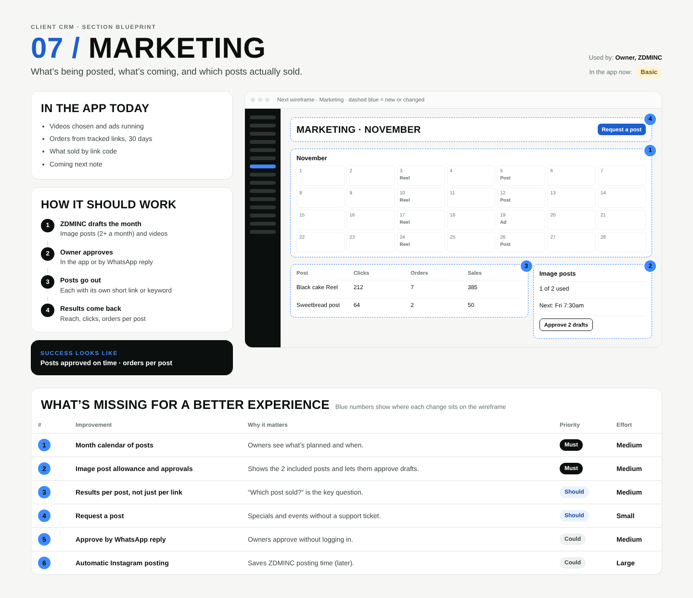

# 07 / Marketing

**Purpose:** What’s being posted, what’s coming, and which posts actually sold.  
**Used by:** Owner, ZDMINC  
**Status in the app today:** Basic  
**Success measure:** Posts approved on time · orders per post

## Code to start from

- `app/dashboard/[slug]/marketing/page.tsx`

## In the app today

- Videos chosen and ads running
- Orders from tracked links, 30 days
- What sold by link code
- Coming next note

## How it should work

1. **ZDMINC drafts the month**: Image posts (2+ a month) and videos
2. **Owner approves**: In the app or by WhatsApp reply
3. **Posts go out**: Each with its own short link or keyword
4. **Results come back**: Reach, clicks, orders per post

## Next wireframe (what the screen should contain)

- **bar** Marketing · November: actions Request a post (improvement #4)
- **calendar** calendar (improvement #1)
- **table** table: Black cake Reel | 212 | 7 | 385; Sweetbread post | 64 | 2 | 50 (improvement #3)
- **side** Image posts: 1 of 2 used; Next: Fri 7:30am; [Approve 2 drafts] (improvement #2)

## What's missing (build these)

| # | Improvement | Why it matters | Priority | Effort |
|---|---|---|---|---|
| 1 | Month calendar of posts | Owners see what’s planned and when. | Must | Medium (1 to 3 days) |
| 2 | Image post allowance and approvals | Shows the 2 included posts and lets them approve drafts. | Must | Medium (1 to 3 days) |
| 3 | Results per post, not just per link | “Which post sold?” is the key question. | Should | Medium (1 to 3 days) |
| 4 | Request a post | Specials and events without a support ticket. | Should | Small (under a day) |
| 5 | Approve by WhatsApp reply | Owners approve without logging in. | Could | Medium (1 to 3 days) |
| 6 | Automatic Instagram posting | Saves ZDMINC posting time (later). | Could | Large (more than 3 days) |

## Done means

- Works on a 390px phone with no sideways scroll; buttons at least 44px tall; inputs 16px.
- Uses the existing CRM shell (`components/CrmShell.tsx`, `PageHeader`) and styles in `app/globals.css`.
- Any new table has RLS (`private.is_member(business_id) or private.is_staff()`), writes go through server actions with an owner/admin check.
- Pure logic lives in `lib/` with a `node:test` test in `tests/`; `npm test` and `npx tsc --noEmit` pass.
