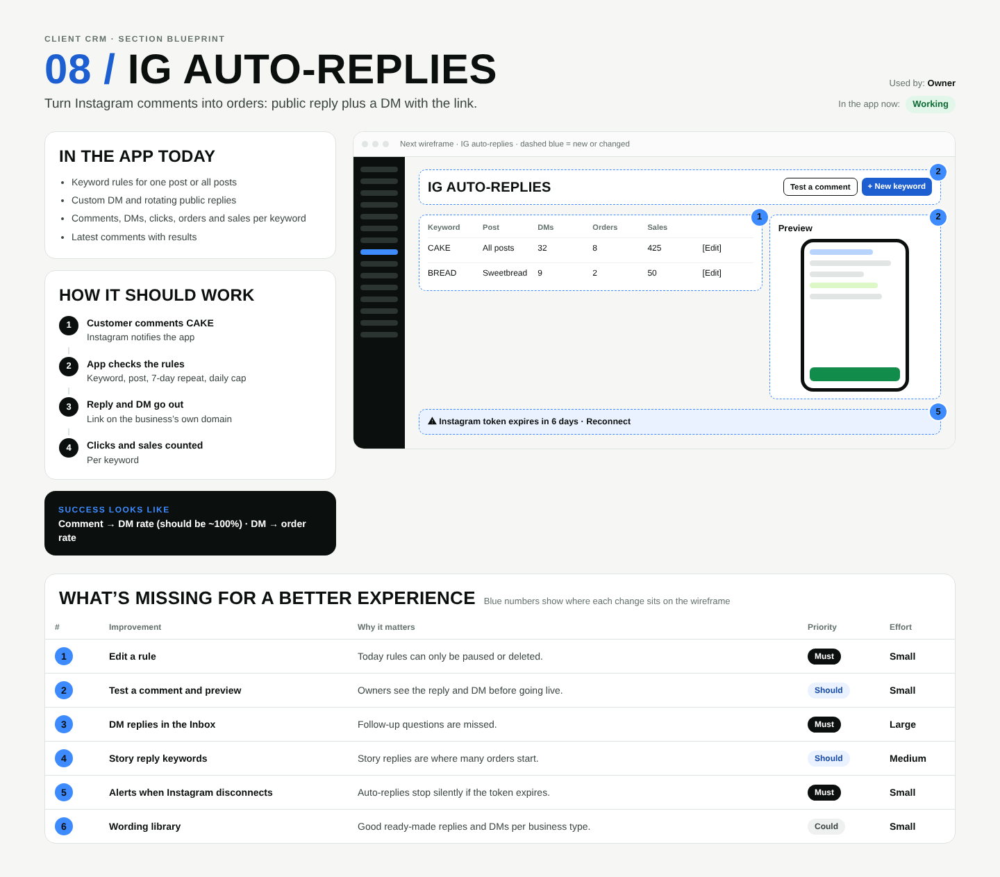

# 08 / IG auto-replies

**Purpose:** Turn Instagram comments into orders: public reply plus a DM with the link.  
**Used by:** Owner  
**Status in the app today:** Working  
**Success measure:** Comment → DM rate (should be ~100%) · DM → order rate

## Code to start from

- `app/dashboard/[slug]/autoreplies/page.tsx`
- `app/api/webhooks/instagram/route.ts`
- `lib/autoreply.ts`
- `lib/instagram.ts`
- `supabase/migrations/0008_ig_autoreplies.sql`

## In the app today

- Keyword rules for one post or all posts
- Custom DM and rotating public replies
- Comments, DMs, clicks, orders and sales per keyword
- Latest comments with results

## How it should work

1. **Customer comments CAKE**: Instagram notifies the app
2. **App checks the rules**: Keyword, post, 7-day repeat, daily cap
3. **Reply and DM go out**: Link on the business’s own domain
4. **Clicks and sales counted**: Per keyword

## Next wireframe (what the screen should contain)

- **bar** IG auto-replies: actions Test a comment, + New keyword (improvement #2)
- **table** table: CAKE | All posts | 32 | 8 | 425 | [Edit]; BREAD | Sweetbread | 9 | 2 | 50 | [Edit] (improvement #1)
- **phone** Preview (improvement #2)
- **strip** ⚠ Instagram token expires in 6 days · Reconnect (improvement #5)

## What's missing (build these)

| # | Improvement | Why it matters | Priority | Effort |
|---|---|---|---|---|
| 1 | Edit a rule | Today rules can only be paused or deleted. | Must | Small (under a day) |
| 2 | Test a comment and preview | Owners see the reply and DM before going live. | Should | Small (under a day) |
| 3 | DM replies in the Inbox | Follow-up questions are missed. | Must | Large (more than 3 days) |
| 4 | Story reply keywords | Story replies are where many orders start. | Should | Medium (1 to 3 days) |
| 5 | Alerts when Instagram disconnects | Auto-replies stop silently if the token expires. | Must | Small (under a day) |
| 6 | Wording library | Good ready-made replies and DMs per business type. | Could | Small (under a day) |

## Done means

- Works on a 390px phone with no sideways scroll; buttons at least 44px tall; inputs 16px.
- Uses the existing CRM shell (`components/CrmShell.tsx`, `PageHeader`) and styles in `app/globals.css`.
- Any new table has RLS (`private.is_member(business_id) or private.is_staff()`), writes go through server actions with an owner/admin check.
- Pure logic lives in `lib/` with a `node:test` test in `tests/`; `npm test` and `npx tsc --noEmit` pass.
