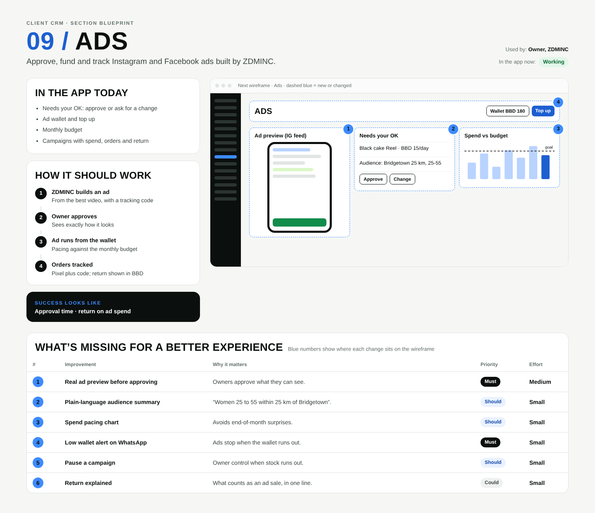

# 09 / Ads

**Purpose:** Approve, fund and track Instagram and Facebook ads built by ZDMINC.  
**Used by:** Owner, ZDMINC  
**Status in the app today:** Working  
**Success measure:** Approval time · return on ad spend

## Code to start from

- `app/dashboard/[slug]/ads/page.tsx`
- `app/admin/ads/page.tsx`
- `lib/meta.ts`
- `supabase/migrations/0004_ads.sql`

## In the app today

- Needs your OK: approve or ask for a change
- Ad wallet and top up
- Monthly budget
- Campaigns with spend, orders and return

## How it should work

1. **ZDMINC builds an ad**: From the best video, with a tracking code
2. **Owner approves**: Sees exactly how it looks
3. **Ad runs from the wallet**: Pacing against the monthly budget
4. **Orders tracked**: Pixel plus code; return shown in BBD

## Next wireframe (what the screen should contain)

- **bar** Ads: actions Wallet BBD 180, Top up (improvement #4)
- **phone** Ad preview (IG feed) (improvement #1)
- **list** Needs your OK: Black cake Reel · BBD 15/day; Audience: Bridgetown 25 km, 25-55; [Approve] [Change] (improvement #2)
- **chart** Spend vs budget (improvement #3)

## What's missing (build these)

| # | Improvement | Why it matters | Priority | Effort |
|---|---|---|---|---|
| 1 | Real ad preview before approving | Owners approve what they can see. | Must | Medium (1 to 3 days) |
| 2 | Plain-language audience summary | “Women 25 to 55 within 25 km of Bridgetown”. | Should | Small (under a day) |
| 3 | Spend pacing chart | Avoids end-of-month surprises. | Should | Small (under a day) |
| 4 | Low wallet alert on WhatsApp | Ads stop when the wallet runs out. | Must | Small (under a day) |
| 5 | Pause a campaign | Owner control when stock runs out. | Should | Small (under a day) |
| 6 | Return explained | What counts as an ad sale, in one line. | Could | Small (under a day) |

## Done means

- Works on a 390px phone with no sideways scroll; buttons at least 44px tall; inputs 16px.
- Uses the existing CRM shell (`components/CrmShell.tsx`, `PageHeader`) and styles in `app/globals.css`.
- Any new table has RLS (`private.is_member(business_id) or private.is_staff()`), writes go through server actions with an owner/admin check.
- Pure logic lives in `lib/` with a `node:test` test in `tests/`; `npm test` and `npx tsc --noEmit` pass.
