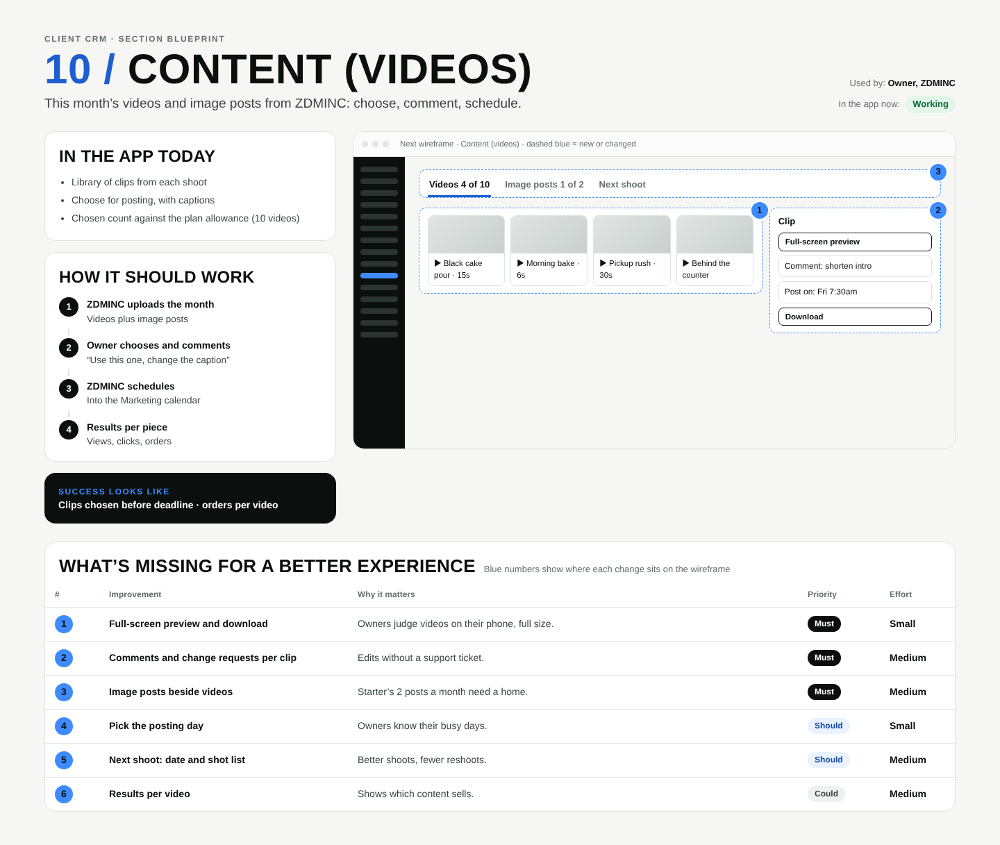

# 10 / Content (videos)

**Purpose:** This month’s videos and image posts from ZDMINC: choose, comment, schedule.  
**Used by:** Owner, ZDMINC  
**Status in the app today:** Working  
**Success measure:** Clips chosen before deadline · orders per video

## Code to start from

- `app/dashboard/[slug]/videos/page.tsx`
- `app/admin/videos/page.tsx`

## In the app today

- Library of clips from each shoot
- Choose for posting, with captions
- Chosen count against the plan allowance (10 videos)

## How it should work

1. **ZDMINC uploads the month**: Videos plus image posts
2. **Owner chooses and comments**: “Use this one, change the caption”
3. **ZDMINC schedules**: Into the Marketing calendar
4. **Results per piece**: Views, clicks, orders

## Next wireframe (what the screen should contain)

- **tabs** Videos 4 of 10, Image posts 1 of 2, Next shoot (improvement #3)
- **grid** ▶ Black cake pour · 15s, ▶ Morning bake · 6s, ▶ Pickup rush · 30s, ▶ Behind the counter (improvement #1)
- **form** Clip: [Full-screen preview]; Comment: shorten intro; Post on: Fri 7:30am; [Download] (improvement #2)

## What's missing (build these)

| # | Improvement | Why it matters | Priority | Effort |
|---|---|---|---|---|
| 1 | Full-screen preview and download | Owners judge videos on their phone, full size. | Must | Small (under a day) |
| 2 | Comments and change requests per clip | Edits without a support ticket. | Must | Medium (1 to 3 days) |
| 3 | Image posts beside videos | Starter’s 2 posts a month need a home. | Must | Medium (1 to 3 days) |
| 4 | Pick the posting day | Owners know their busy days. | Should | Small (under a day) |
| 5 | Next shoot: date and shot list | Better shoots, fewer reshoots. | Should | Medium (1 to 3 days) |
| 6 | Results per video | Shows which content sells. | Could | Medium (1 to 3 days) |

## Done means

- Works on a 390px phone with no sideways scroll; buttons at least 44px tall; inputs 16px.
- Uses the existing CRM shell (`components/CrmShell.tsx`, `PageHeader`) and styles in `app/globals.css`.
- Any new table has RLS (`private.is_member(business_id) or private.is_staff()`), writes go through server actions with an owner/admin check.
- Pure logic lives in `lib/` with a `node:test` test in `tests/`; `npm test` and `npx tsc --noEmit` pass.
