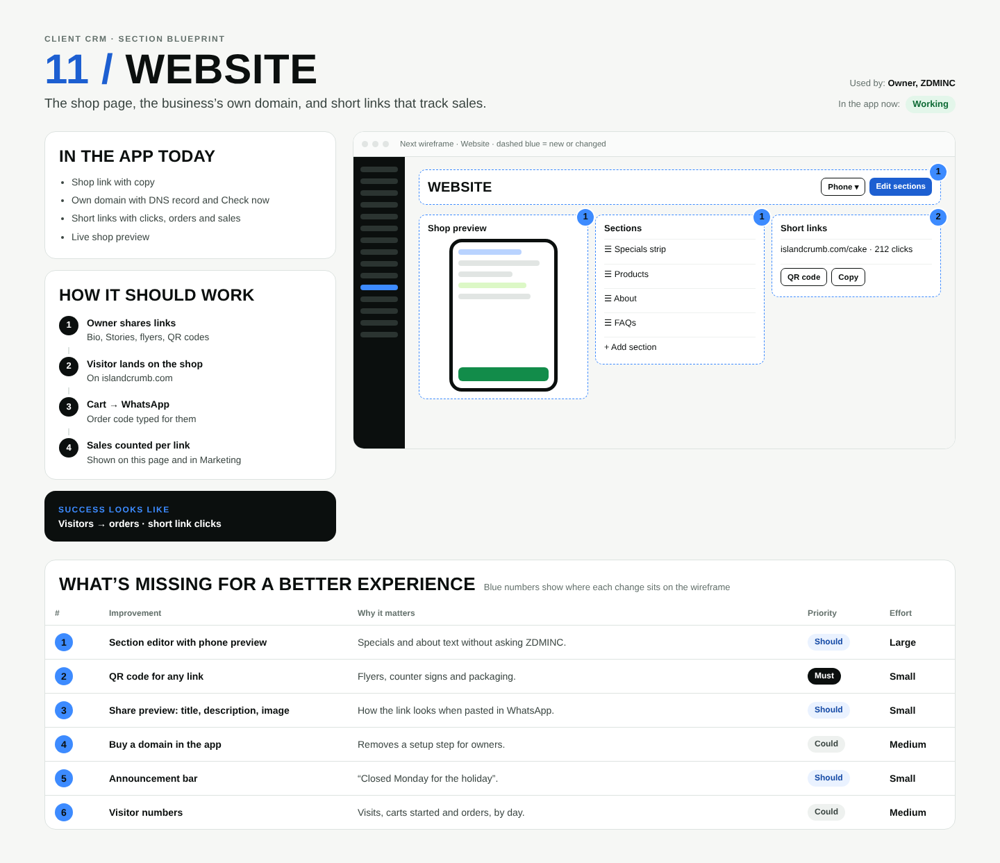

# 11 / Website

**Purpose:** The shop page, the business’s own domain, and short links that track sales.  
**Used by:** Owner, ZDMINC  
**Status in the app today:** Working  
**Success measure:** Visitors → orders · short link clicks

## Code to start from

- `app/dashboard/[slug]/website/page.tsx`
- `lib/links.ts`
- `lib/domains.ts`
- `app/l/[code]/route.ts`
- `middleware.ts`

## In the app today

- Shop link with copy
- Own domain with DNS record and Check now
- Short links with clicks, orders and sales
- Live shop preview

## How it should work

1. **Owner shares links**: Bio, Stories, flyers, QR codes
2. **Visitor lands on the shop**: On islandcrumb.com
3. **Cart → WhatsApp**: Order code typed for them
4. **Sales counted per link**: Shown on this page and in Marketing

## Next wireframe (what the screen should contain)

- **bar** Website: actions Phone ▾, Edit sections (improvement #1)
- **phone** Shop preview (improvement #1)
- **list** Sections: ☰ Specials strip; ☰ Products; ☰ About; ☰ FAQs; + Add section (improvement #1)
- **list** Short links: islandcrumb.com/cake · 212 clicks; [QR code] [Copy] (improvement #2)

## What's missing (build these)

| # | Improvement | Why it matters | Priority | Effort |
|---|---|---|---|---|
| 1 | Section editor with phone preview | Specials and about text without asking ZDMINC. | Should | Large (more than 3 days) |
| 2 | QR code for any link | Flyers, counter signs and packaging. | Must | Small (under a day) |
| 3 | Share preview: title, description, image | How the link looks when pasted in WhatsApp. | Should | Small (under a day) |
| 4 | Buy a domain in the app | Removes a setup step for owners. | Could | Medium (1 to 3 days) |
| 5 | Announcement bar | “Closed Monday for the holiday”. | Should | Small (under a day) |
| 6 | Visitor numbers | Visits, carts started and orders, by day. | Could | Medium (1 to 3 days) |

## Done means

- Works on a 390px phone with no sideways scroll; buttons at least 44px tall; inputs 16px.
- Uses the existing CRM shell (`components/CrmShell.tsx`, `PageHeader`) and styles in `app/globals.css`.
- Any new table has RLS (`private.is_member(business_id) or private.is_staff()`), writes go through server actions with an owner/admin check.
- Pure logic lives in `lib/` with a `node:test` test in `tests/`; `npm test` and `npx tsc --noEmit` pass.
