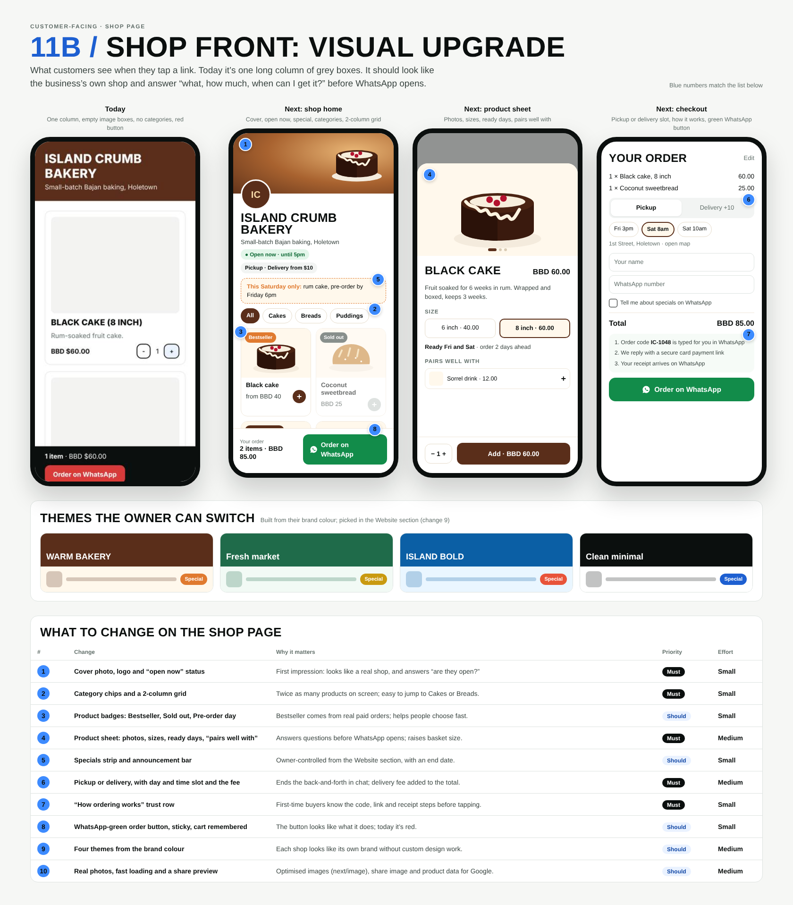

# 11b / Shop front: visual upgrade (customer-facing)

**What it is:** the public shop page customers land on from links (`/s/[slug]`, or the business's own domain).  
**Status today:** one column of products, empty grey image boxes when there's no photo, no categories, no open/closed status, a red Order on WhatsApp button, and opening hours and delivery info at the very bottom.

## Code to start from

- `app/s/[slug]/page.tsx` (loads business and products)
- `app/s/[slug]/ShopClient.tsx` (the whole shop UI, cart and checkout)
- `app/api/orders/route.ts` (creates the order and the WhatsApp link)
- `app/preview/shop/page.tsx` (development-only sample shop with Island Crumb data: run `npm run dev` and open `/preview/shop`)

## The three new screens

1. **Shop home:** cover image band, round logo overlapping it, name and tagline, an “Open now · until 5pm” chip (from structured opening hours) and a “Pickup · Delivery from $10” chip; a specials strip with an end date; sticky category chips; a 2-column product grid with photo, badge, name, price (“from” when there are sizes) and a round + button; a sticky bottom bar with item count, total and a WhatsApp-green “Order on WhatsApp” button with the WhatsApp icon.
2. **Product sheet** (bottom sheet when a product is tapped): photo carousel, name and price, description, size options with their own prices, ready days and lead time, “pairs well with” suggestion, quantity stepper and “Add · BBD 60.00”.
3. **Checkout** (replaces the dark cart panel): order lines, Pickup / Delivery toggle with the delivery fee, day and time slot chips, pickup address with map link, name and WhatsApp number, specials opt-in, total, a 3-step “how ordering works” box (code typed for you, secure card link, receipt on WhatsApp), then the green WhatsApp button.

Themes: Warm bakery, Fresh market, Island bold, Clean minimal. Each is built from the business's `brand_color` plus one accent and a heading font; chosen in the CRM Website section.

## Changes

| # | Change | Why it matters | Priority | Effort |
|---|---|---|---|---|
| 1 | Cover photo, logo and “open now” status | First impression: looks like a real shop, and answers “are they open?” | Must | Small |
| 2 | Category chips and a 2-column grid | Twice as many products on screen; easy to jump to Cakes or Breads. | Must | Small |
| 3 | Product badges: Bestseller, Sold out, Pre-order day | Bestseller comes from real paid orders; helps people choose fast. | Should | Small |
| 4 | Product sheet: photos, sizes, ready days, “pairs well with” | Answers questions before WhatsApp opens; raises basket size. | Must | Medium |
| 5 | Specials strip and announcement bar | Owner-controlled from the Website section, with an end date. | Should | Small |
| 6 | Pickup or delivery, with day and time slot and the fee | Ends the back-and-forth in chat; delivery fee added to the total. | Must | Medium |
| 7 | “How ordering works” trust row | First-time buyers know the code, link and receipt steps before tapping. | Must | Small |
| 8 | WhatsApp-green order button, sticky, cart remembered | The button looks like what it does; today it’s red. | Should | Small |
| 9 | Four themes from the brand colour | Each shop looks like its own brand without custom design work. | Should | Medium |
| 10 | Real photos, fast loading and a share preview | Optimised images (next/image), share image and product data for Google. | Should | Medium |

## Data this needs

- `products`: `category`, `badge` override, `options` (sizes with prices), `ready_days`, `lead_days`, `images[]`, `pairs_with` (see Products section 06).
- `businesses`: `cover_url`, structured `hours` (per day, for “open now”), `delivery_zones` with fees, `theme`, `special_text` + `special_ends_at`, `announcement` (see sections 11 and 13).
- Bestseller badge: top products by paid quantity in the last 30 days (computed, not stored).
- Pickup/delivery slot and fee must be saved on the order and shown in the WhatsApp summary and receipt.

## Done means

- Looks right at 390px wide and on desktop (grid goes to 3 to 4 columns); no sideways scroll.
- Lighthouse mobile performance 90+ (use `next/image`, lazy-load below the fold).
- Works with no photos (tasteful placeholder with the product initial and brand colour, not a grey box).
- Share preview (Open Graph image, title, description) per shop; product structured data for Google.
- Cart still survives a refresh; the order code flow and `?ref` tracking keep working.
