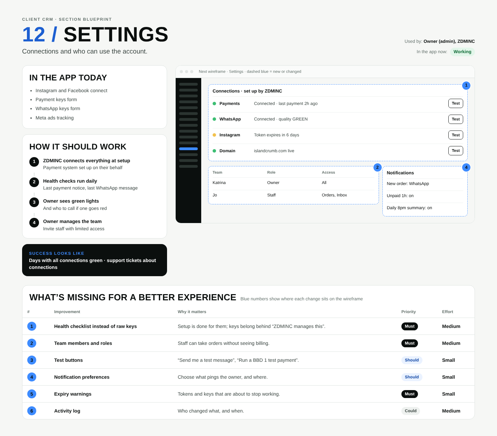

# 12 / Settings

**Purpose:** Connections and who can use the account.  
**Used by:** Owner (admin), ZDMINC  
**Status in the app today:** Working  
**Success measure:** Days with all connections green · support tickets about connections

## Code to start from

- `app/dashboard/[slug]/settings/page.tsx`
- `lib/social.ts`
- `app/api/social/*`

## In the app today

- Instagram and Facebook connect
- Payment keys form
- WhatsApp keys form
- Meta ads tracking

## How it should work

1. **ZDMINC connects everything at setup**: Payment system set up on their behalf
2. **Health checks run daily**: Last payment notice, last WhatsApp message
3. **Owner sees green lights**: And who to call if one goes red
4. **Owner manages the team**: Invite staff with limited access

## Next wireframe (what the screen should contain)

- **checklist** Payments, WhatsApp, Instagram, Domain (improvement #1)
- **table** table: Katrina | Owner | All; Jo | Staff | Orders, Inbox (improvement #2)
- **side** Notifications: New order: WhatsApp; Unpaid 1h: on; Daily 8pm summary: on (improvement #4)

## What's missing (build these)

| # | Improvement | Why it matters | Priority | Effort |
|---|---|---|---|---|
| 1 | Health checklist instead of raw keys | Setup is done for them; keys belong behind “ZDMINC manages this”. | Must | Medium (1 to 3 days) |
| 2 | Team members and roles | Staff can take orders without seeing billing. | Must | Medium (1 to 3 days) |
| 3 | Test buttons | “Send me a test message”, “Run a BBD 1 test payment”. | Should | Small (under a day) |
| 4 | Notification preferences | Choose what pings the owner, and where. | Should | Small (under a day) |
| 5 | Expiry warnings | Tokens and keys that are about to stop working. | Must | Small (under a day) |
| 6 | Activity log | Who changed what, and when. | Could | Medium (1 to 3 days) |

## Done means

- Works on a 390px phone with no sideways scroll; buttons at least 44px tall; inputs 16px.
- Uses the existing CRM shell (`components/CrmShell.tsx`, `PageHeader`) and styles in `app/globals.css`.
- Any new table has RLS (`private.is_member(business_id) or private.is_staff()`), writes go through server actions with an owner/admin check.
- Pure logic lives in `lib/` with a `node:test` test in `tests/`; `npm test` and `npx tsc --noEmit` pass.
