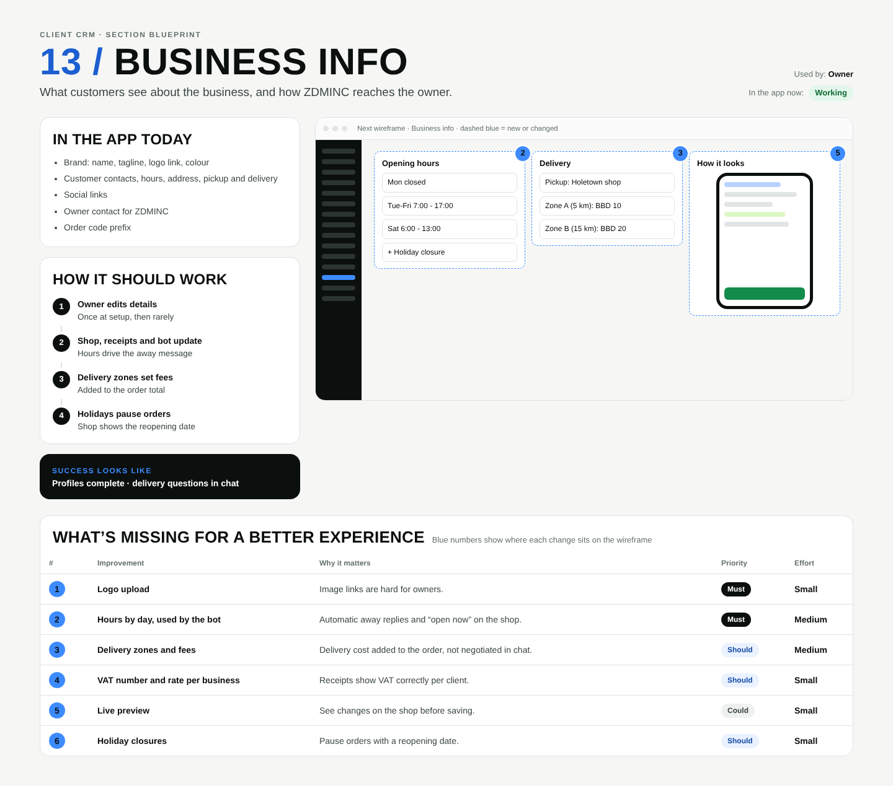

# 13 / Business info

**Purpose:** What customers see about the business, and how ZDMINC reaches the owner.  
**Used by:** Owner  
**Status in the app today:** Working  
**Success measure:** Profiles complete · delivery questions in chat

## Code to start from

- `app/dashboard/[slug]/business/page.tsx`
- `lib/receipt.ts (VAT)`

## In the app today

- Brand: name, tagline, logo link, colour
- Customer contacts, hours, address, pickup and delivery
- Social links
- Owner contact for ZDMINC
- Order code prefix

## How it should work

1. **Owner edits details**: Once at setup, then rarely
2. **Shop, receipts and bot update**: Hours drive the away message
3. **Delivery zones set fees**: Added to the order total
4. **Holidays pause orders**: Shop shows the reopening date

## Next wireframe (what the screen should contain)

- **form** Opening hours: Mon  closed; Tue-Fri  7:00 - 17:00; Sat  6:00 - 13:00; + Holiday closure (improvement #2)
- **form** Delivery: Pickup: Holetown shop; Zone A (5 km): BBD 10; Zone B (15 km): BBD 20 (improvement #3)
- **phone** How it looks (improvement #5)

## What's missing (build these)

| # | Improvement | Why it matters | Priority | Effort |
|---|---|---|---|---|
| 1 | Logo upload | Image links are hard for owners. | Must | Small (under a day) |
| 2 | Hours by day, used by the bot | Automatic away replies and “open now” on the shop. | Must | Medium (1 to 3 days) |
| 3 | Delivery zones and fees | Delivery cost added to the order, not negotiated in chat. | Should | Medium (1 to 3 days) |
| 4 | VAT number and rate per business | Receipts show VAT correctly per client. | Should | Small (under a day) |
| 5 | Live preview | See changes on the shop before saving. | Could | Small (under a day) |
| 6 | Holiday closures | Pause orders with a reopening date. | Should | Small (under a day) |

## Done means

- Works on a 390px phone with no sideways scroll; buttons at least 44px tall; inputs 16px.
- Uses the existing CRM shell (`components/CrmShell.tsx`, `PageHeader`) and styles in `app/globals.css`.
- Any new table has RLS (`private.is_member(business_id) or private.is_staff()`), writes go through server actions with an owner/admin check.
- Pure logic lives in `lib/` with a `node:test` test in `tests/`; `npm test` and `npx tsc --noEmit` pass.
