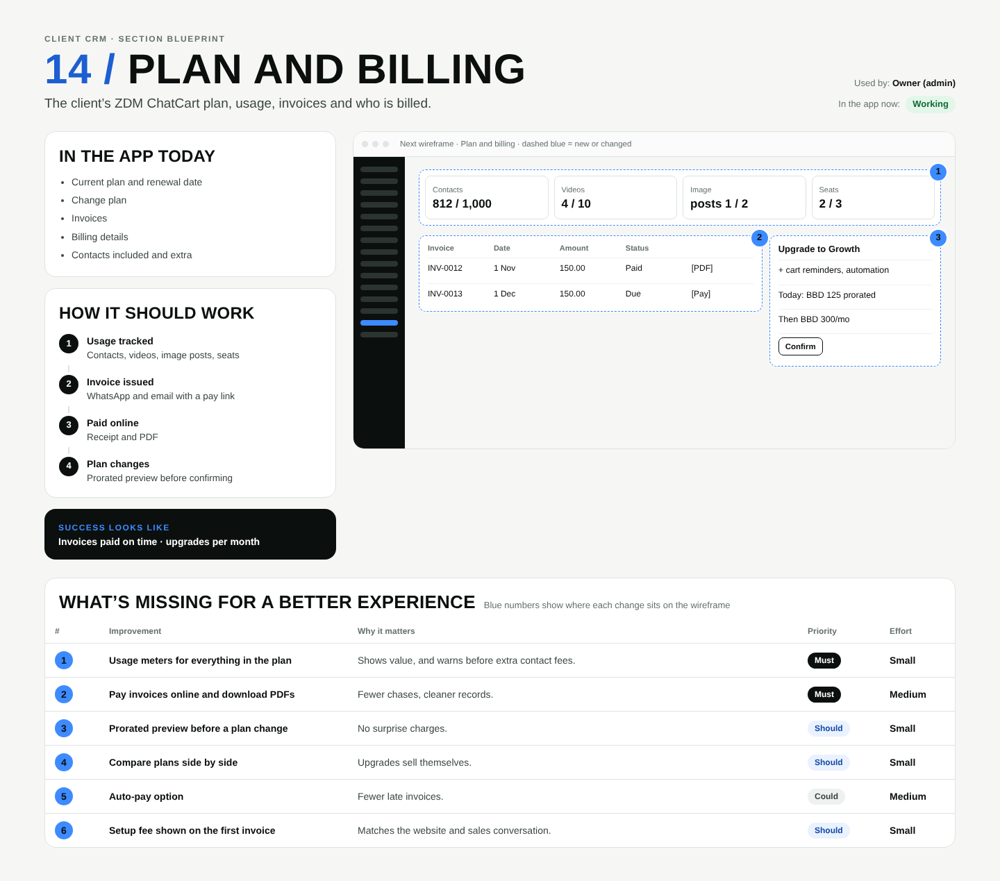

# 14 / Plan and billing

**Purpose:** The client’s ZDM ChatCart plan, usage, invoices and who is billed.  
**Used by:** Owner (admin)  
**Status in the app today:** Working  
**Success measure:** Invoices paid on time · upgrades per month

## Code to start from

- `app/dashboard/[slug]/billing/page.tsx`
- `lib/billing.ts`
- `app/admin/billing/page.tsx`
- `app/api/cron/billing/route.ts`

## In the app today

- Current plan and renewal date
- Change plan
- Invoices
- Billing details
- Contacts included and extra

## How it should work

1. **Usage tracked**: Contacts, videos, image posts, seats
2. **Invoice issued**: WhatsApp and email with a pay link
3. **Paid online**: Receipt and PDF
4. **Plan changes**: Prorated preview before confirming

## Next wireframe (what the screen should contain)

- **kpis** Contacts 812 / 1,000, Videos 4 / 10, Image posts 1 / 2, Seats 2 / 3 (improvement #1)
- **table** table: INV-0012 | 1 Nov | 150.00 | Paid | [PDF]; INV-0013 | 1 Dec | 150.00 | Due | [Pay] (improvement #2)
- **side** Upgrade to Growth: + cart reminders, automation; Today: BBD 125 prorated; Then BBD 300/mo; [Confirm] (improvement #3)

## What's missing (build these)

| # | Improvement | Why it matters | Priority | Effort |
|---|---|---|---|---|
| 1 | Usage meters for everything in the plan | Shows value, and warns before extra contact fees. | Must | Small (under a day) |
| 2 | Pay invoices online and download PDFs | Fewer chases, cleaner records. | Must | Medium (1 to 3 days) |
| 3 | Prorated preview before a plan change | No surprise charges. | Should | Small (under a day) |
| 4 | Compare plans side by side | Upgrades sell themselves. | Should | Small (under a day) |
| 5 | Auto-pay option | Fewer late invoices. | Could | Medium (1 to 3 days) |
| 6 | Setup fee shown on the first invoice | Matches the website and sales conversation. | Should | Small (under a day) |

## Done means

- Works on a 390px phone with no sideways scroll; buttons at least 44px tall; inputs 16px.
- Uses the existing CRM shell (`components/CrmShell.tsx`, `PageHeader`) and styles in `app/globals.css`.
- Any new table has RLS (`private.is_member(business_id) or private.is_staff()`), writes go through server actions with an owner/admin check.
- Pure logic lives in `lib/` with a `node:test` test in `tests/`; `npm test` and `npx tsc --noEmit` pass.
