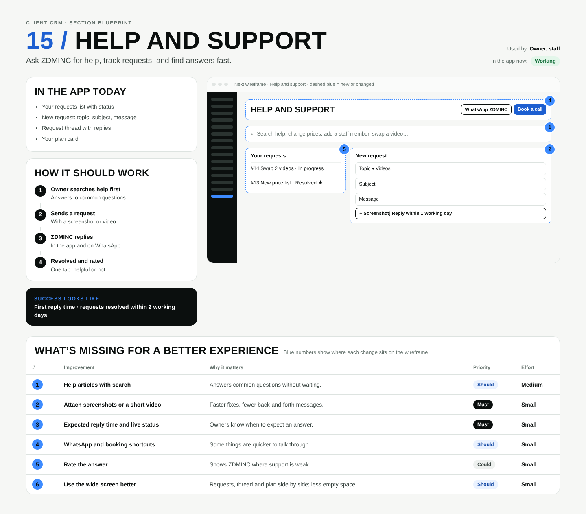

# 15 / Help and support

**Purpose:** Ask ZDMINC for help, track requests, and find answers fast.  
**Used by:** Owner, staff  
**Status in the app today:** Working  
**Success measure:** First reply time · requests resolved within 2 working days

## Code to start from

- `app/dashboard/[slug]/support/page.tsx`
- `app/dashboard/[slug]/support/actions.ts`
- `app/admin/support/page.tsx`

## In the app today

- Your requests list with status
- New request: topic, subject, message
- Request thread with replies
- Your plan card

## How it should work

1. **Owner searches help first**: Answers to common questions
2. **Sends a request**: With a screenshot or video
3. **ZDMINC replies**: In the app and on WhatsApp
4. **Resolved and rated**: One tap: helpful or not

## Next wireframe (what the screen should contain)

- **bar** Help and support: actions WhatsApp ZDMINC, Book a call (improvement #4)
- **search** Search help: change prices, add a staff member, swap a video… (improvement #1)
- **list** Your requests: #14 Swap 2 videos · In progress; #13 New price list · Resolved ★ (improvement #5)
- **form** New request: Topic ▾  Videos; Subject; Message; [+ Screenshot]  Reply within 1 working day (improvement #2)

## What's missing (build these)

| # | Improvement | Why it matters | Priority | Effort |
|---|---|---|---|---|
| 1 | Help articles with search | Answers common questions without waiting. | Should | Medium (1 to 3 days) |
| 2 | Attach screenshots or a short video | Faster fixes, fewer back-and-forth messages. | Must | Small (under a day) |
| 3 | Expected reply time and live status | Owners know when to expect an answer. | Must | Small (under a day) |
| 4 | WhatsApp and booking shortcuts | Some things are quicker to talk through. | Should | Small (under a day) |
| 5 | Rate the answer | Shows ZDMINC where support is weak. | Could | Small (under a day) |
| 6 | Use the wide screen better | Requests, thread and plan side by side; less empty space. | Should | Small (under a day) |

## Done means

- Works on a 390px phone with no sideways scroll; buttons at least 44px tall; inputs 16px.
- Uses the existing CRM shell (`components/CrmShell.tsx`, `PageHeader`) and styles in `app/globals.css`.
- Any new table has RLS (`private.is_member(business_id) or private.is_staff()`), writes go through server actions with an owner/admin check.
- Pure logic lives in `lib/` with a `node:test` test in `tests/`; `npm test` and `npx tsc --noEmit` pass.
